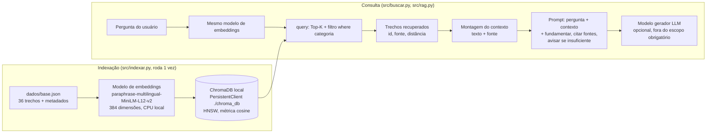

# Fluxo da solução



Versão em texto (para o slide do vídeo, se o Mermaid não renderizar):

```
base.json ─► [embeddings] ─► ChromaDB (disco)
                                   │
pergunta ─► [mesmo modelo] ─► query Top-K (+ filtro) ─► trechos + fontes
                                                          │
                                             contexto + instruções ─► PROMPT ─► (LLM gerador)
```

Para gerar uma imagem: cole o bloco mermaid em https://mermaid.live e exporte PNG.
